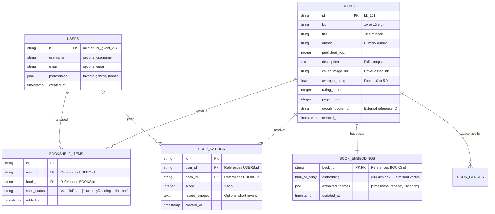

# 🗄️ Database Schema & Storage Specification

> **Database:** SQLite (for zero-latency local hackathon execution) or PostgreSQL (with `pgvector`)  
> **ORM Recommendation:** SQLAlchemy (Python) or Prisma (Node.js)  
> **Owner:** Backend Developer 1 (in coordination with Backend Developer 2 for embeddings)  

---

## 1. Entity-Relationship (ER) Diagram



---

## 2. SQL DDL Table Definitions (SQLite & PostgreSQL Compatible)

```sql
-- 1. Users Table (Supports instant Guest Sessions)
CREATE TABLE IF NOT EXISTS users (
    id VARCHAR(64) PRIMARY KEY,
    username VARCHAR(100),
    email VARCHAR(255),
    is_guest BOOLEAN DEFAULT TRUE,
    preferences_json TEXT DEFAULT '{}',
    created_at TIMESTAMP DEFAULT CURRENT_TIMESTAMP
);

-- 2. Books Catalog
CREATE TABLE IF NOT EXISTS books (
    id VARCHAR(64) PRIMARY KEY,
    isbn VARCHAR(20) UNIQUE,
    title VARCHAR(255) NOT NULL,
    author VARCHAR(255) NOT NULL,
    published_year INTEGER,
    description TEXT,
    cover_image_url TEXT,
    average_rating REAL DEFAULT 0.0,
    rating_count INTEGER DEFAULT 0,
    page_count INTEGER,
    genres TEXT, -- comma-separated or JSON array: ["Sci-Fi", "Thriller"]
    google_books_id VARCHAR(64),
    created_at TIMESTAMP DEFAULT CURRENT_TIMESTAMP
);

-- 3. Bookshelf Items (Reading Tracker)
CREATE TABLE IF NOT EXISTS bookshelf_items (
    id VARCHAR(64) PRIMARY KEY,
    user_id VARCHAR(64) NOT NULL,
    book_id VARCHAR(64) NOT NULL,
    shelf_status VARCHAR(32) NOT NULL CHECK(shelf_status IN ('wantToRead', 'currentlyReading', 'finished')),
    added_at TIMESTAMP DEFAULT CURRENT_TIMESTAMP,
    FOREIGN KEY(user_id) REFERENCES users(id) ON DELETE CASCADE,
    FOREIGN KEY(book_id) REFERENCES books(id) ON DELETE CASCADE,
    UNIQUE(user_id, book_id)
);

-- 4. User Ratings & Feedback (For Collaborative Filtering)
CREATE TABLE IF NOT EXISTS user_ratings (
    id VARCHAR(64) PRIMARY KEY,
    user_id VARCHAR(64) NOT NULL,
    book_id VARCHAR(64) NOT NULL,
    rating INTEGER CHECK(rating >= 1 AND rating <= 5),
    review_snippet TEXT,
    created_at TIMESTAMP DEFAULT CURRENT_TIMESTAMP,
    FOREIGN KEY(user_id) REFERENCES users(id) ON DELETE CASCADE,
    FOREIGN KEY(book_id) REFERENCES books(id) ON DELETE CASCADE
);

-- 5. Book Embeddings Metadata Table (Backend 2)
CREATE TABLE IF NOT EXISTS book_embeddings (
    book_id VARCHAR(64) PRIMARY KEY,
    embedding_dimension INTEGER DEFAULT 384,
    theme_tags_json TEXT, -- ["cyberpunk", "artificial-intelligence", "noir"]
    vibe_scores_json TEXT, -- {"dark": 0.85, "fastPaced": 0.90}
    FOREIGN KEY(book_id) REFERENCES books(id) ON DELETE CASCADE
);
```

---

## 3. Vector Embeddings Strategy (Backend Developer 2)

### Option A (Simplest & Fastest for Hackathons - NumPy + In-Memory Cosine Similarity):
- Backend 2 generates an `embeddings.json` or `embeddings.npy` file:
  - Vector length: 384 dimensions (`sentence-transformers/all-MiniLM-L6-v2`) or 768 dimensions (Gemini Embedding `text-embedding-004`).
- Upon server startup, load the array into RAM:
  ```python
  import numpy as np
  # book_ids: list of strings
  # vectors: shape (N, 384)
  # Cosine similarity = dot(vectors, query_vec) / (norm(vectors) * norm(query_vec))
  ```
- **Query speed:** < 5 milliseconds for 5,000 books! Zero external vector database setup required.

### Option B (ChromaDB / FAISS):
- `pip install chromadb`
- Create a collection `books_collection` and query `collection.query(query_texts=[user_prompt], n_results=6)`.

---

## 4. Starter Seed Dataset (Pre-Packaged)

Backend 1 and 2 should initialize the database with 50 curated popular books spanning 7 distinct genres:
1. **Hard Sci-Fi / Space** (*Project Hail Mary*, *Dune*, *The Three-Body Problem*, *Neuromancer*)
2. **Psychological Thriller / Noir** (*Gone Girl*, *The Silent Patient*, *Dark Matter*, *Shutter Island*)
3. **Fantasy / World-Building** (*The Name of the Wind*, *Mistborn*, *The Way of Kings*, *Circe*)
4. **Cozy / Wholesome** (*The House in the Cerulean Sea*, *A Man Called Ove*, *Legends & Lattes*)
5. **Non-Fiction / Brainy** (*Sapiens*, *Atomic Habits*, *Thinking Fast and Slow*, *Deep Work*)
6. **Literary Fiction / Emotional** (*Klara and the Sun*, *Tomorrow and Tomorrow and Tomorrow*, *A Little Life*)
7. **Horror / Gothic** (*Mexican Gothic*, *Bird Box*, *The Shining*)

This guarantees high match accuracy when the presenter demonstrates natural language queries during the live pitch!
