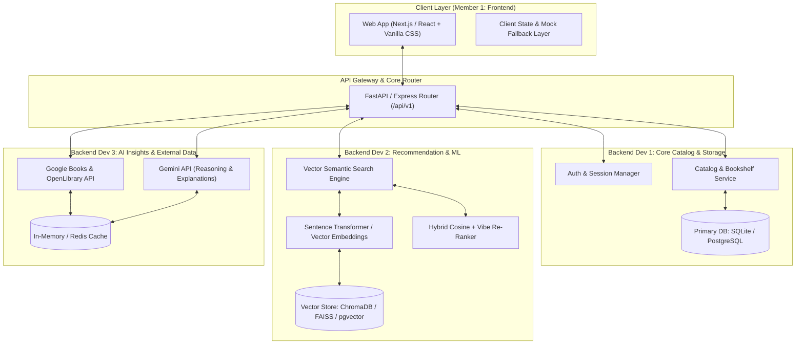
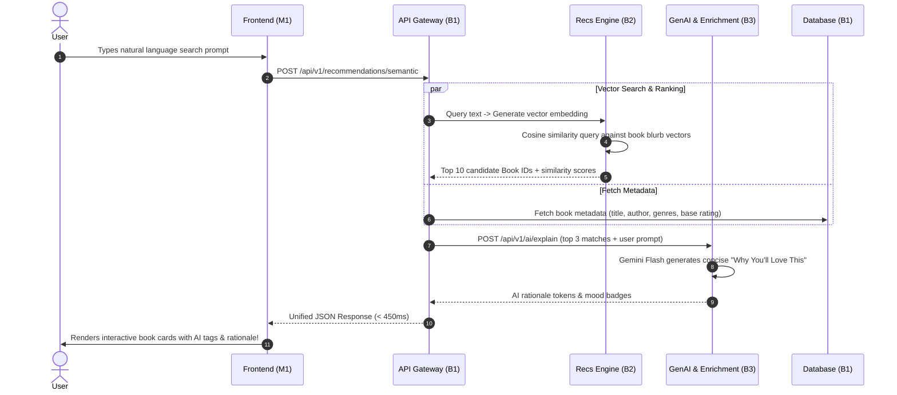

# 🏗️ System Architecture & Engineering Blueprint

> **Project:** NextRead (AI-Powered Intelligent Book Discovery Platform)  
> **Architecture Style:** Modular Service Architecture / Clean API Gateway  
> **Latency Target:** < 500ms End-to-End Search & Recommendation  

---

## 1. High-Level Architecture Diagram



---

## 2. Component Breakdown & Boundaries

| Module | Owner | Technology | Responsibility |
|---|---|---|---|
| **Frontend UI** | Frontend Lead (M1) | Next.js 14 / Vite + React, Modern CSS (Glassmorphism, Dark Mode) | Responsive interface, state management, search autocomplete, bookshelf interaction, micro-animations. |
| **Core Service & DB** | Backend 1 (M2) | Python FastAPI or Node/Express + SQLAlchemy / Prisma + PostgreSQL / SQLite | User authentication, bookshelf CRUD, book catalog relational storage, health checks, route aggregation. |
| **Recs & Vector Engine** | Backend 2 (M3) | Python (FastAPI/NumPy), Sentence-Transformers (`all-MiniLM-L6-v2`) or Gemini Embeddings, ChromaDB / FAISS | Semantic natural language search, book plot vector indexing, hybrid content filtering, vibe scoring. |
| **Enrichment & GenAI** | Backend 3 (M4) | Google Books API, OpenLibrary API, Google Gemini Flash API (`gemini-1.5-flash`), Cache | Live book cover fallback, publication metadata, AI-generated "Why Read This" pitch, review summarizer. |

---

## 3. Data Flow: The "Smart Discovery" Pipeline

Here is what happens when a user types:  
`"A psychological thriller set in a snowstorm where no one can be trusted"`



---

## 4. Hackathon Tech Stack Recommendation

### Recommended Choice: **Next.js (Frontend) + Python FastAPI Monorepo (Backend)**

#### Why this wins hackathons:
1. **Python Monorepo for All 3 Backends:**
   - Backend 1 creates `services/core/` (SQLAlchemy / SQLite).
   - Backend 2 creates `services/recommendations/` (loads ML models directly in Python without inter-language RPC overhead).
   - Backend 3 creates `services/enrichment/` (uses `google-generativeai` and `httpx`).
   - The main `app/main.py` simply mounts all three routers:
     ```python
     app.include_router(core_router, prefix="/api/v1")
     app.include_router(recs_router, prefix="/api/v1")
     app.include_router(enrichment_router, prefix="/api/v1")
     ```
2. **Instant Swagger UI (`/docs`):**
   - FastAPI automatically generates live interactive documentation and test sandbox at `http://localhost:8000/docs`. Member 1 (Frontend) and Member 5 (Pitch Lead) can test every endpoint directly in the browser!
3. **Speed & Reliability:**
   - Lightweight SQLite file (`books.db`) eliminates complex Docker setup on local laptops during the hackathon crunch.
   - `gemini-1.5-flash` provides near-instant (~200ms) LLM reasoning at minimal or zero cost tier.

---

## 5. Resilience & "Judge Proofing" Strategy

During live hackathon judging, external APIs, venue Wi-Fi, or rate limits can fail. The architecture incorporates **three levels of safety**:

1. **Local Pre-computed Embeddings:**
   - 500 top-rated books have pre-computed vector embeddings bundled in the repo (`data/embeddings.npy` or ChromaDB collection). Even if offline, semantic search works 100%!
2. **Fallback AI Explanations:**
   - If the Gemini API call exceeds 800ms or fails with 429/network error, Backend 3 returns a smart heuristic fallback template:  
     `"Matches your interest in suspense and isolated atmospheres based on plot tags."`
3. **Client-Side Offline Mode:**
   - Member 1 keeps a fallback `mockBooks.json` in the frontend codebase. If the backend fails to connect, a toggle button allows the pitch presenter to seamlessly switch to demonstration mode.
