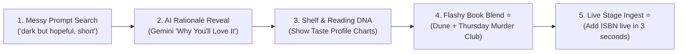

# 📜 Member Contract: Presentation, Product & Pitch Lead
## Domain: Pitch Deck, Demo Choreography, Product Strategy & Submission

> **Owner:** Member 5 (Presentation & Pitch Lead)  
> **Key Objective:** Win the hackathon on stage through a mesmerizing 3-minute pitch, flawless live demo choreography, judging criteria alignment, and airtight Q&A defense.

---

## 1. Core Deliverables & Timeline

| Deliverable | Due Time | Description |
|---|---|---|
| **Problem & Hook Script** | Hour 3 | The 30-second opening hook contrasting broken 2008 Goodreads algorithms with modern AI taste modeling. |
| **8-Slide Pitch Deck** | Hour 12 | Completed slide deck (Google Slides / Figma) following the structure in [PITCH_AND_DEMO_PLAYBOOK.md](file:///c:/Users/acer/OneDrive/Desktop/Navya/hacklezgo/docs/PITCH_AND_DEMO_PLAYBOOK.md). |
| **Demo Choreography Plan** | Hour 16 | The exact sequence of clicks, search prompts, and feature transitions for the 90-second live demo. |
| **Backup Demo Video** | Hour 21 | 60-second screen recording with audio voiceover in case venue Wi-Fi or projectors fail. |
| **Devpost / Portal Submission** | Hour 22 | Winning submission text, screenshots, architecture diagram, and GitHub repo links. |
| **Pitch Rehearsals** | Hour 22 – 24 | Rehearse the 3-minute pitch at least 5 times with the full team timing every second. |

---

## 2. Live Demo Click-Path Choreography (90 Seconds)

You must lead the judge walkthrough using this exact 5-step path:

1. **Step 1: The Complex Natural Query (0:00 - 0:25)**
   - Type into the hero bar: *"something dark but hopeful, short, no romance"*.
   - Point out to the judges that conventional search engines choke on negation (*"no romance"*) and abstract moods (*"hopeful"*), but NextRead parses it instantly and surfaces top matches in < 300ms.
2. **Step 2: The Gemini "Why You'll Love It" (0:25 - 0:40)**
   - Hover over the top book card. Read the custom 2-sentence rationale generated specifically for that prompt.
3. **Step 3: Save to Shelf & Taste Profile (0:40 - 0:55)**
   - Click `+ Add to Shelf` on *Dark Matter* and give it 5 stars.
   - Open the "Reading DNA" drawer to show the real-time radar chart adjusting to the user's taste profile.
4. **Step 4: The Showstopper — "Book Blend" (0:55 - 1:15)**
   - Pick two drastically different books (*Project Hail Mary* + *The Thursday Murder Club*).
   - Click **"Blend Books"** to reveal the midpoint vector discovery.
   - Explain: *"This isn't hardcoded—our vector engine literally averaged the 384-dimensional embeddings of both titles."*
5. **Step 5: Live Stage Ingestion (1:15 - 1:30)**
   - Ask a judge or pick a book: paste an ISBN into the quick ingest bar.
   - Show Google Books cover, blurb, and vector embeddings created live in real time!

---

## 3. Tough Judge Questions & Your Defenses

* **"Why not just ask ChatGPT for a book?"**
  - **Your Defense:** *"ChatGPT hallucinates non-existent books, can't check inventory, doesn't visualize covers or ratings, and can't maintain persistent bookshelf state. NextRead grounds recommendations in verified catalog data with sub-300ms vector search."*
* **"How do you monetize this?"**
  - **Your Defense:** *"Three distinct channels: (1) Affiliate revenue (5-10% kickback via Bookshop.org and Kindle links on every book card); (2) Pro Tier for book clubs ($4.99/mo for group shelves and AI discussion prompts); (3) Sponsored discovery for indie authors."*
* **"What happens if your AI hits a rate limit?"**
  - **Your Defense:** *"We engineered zero-fail resilience: every query is cached by `(query_hash, book_id)`, and our backend automatically falls back to deterministic template rationales so the interface never stumbles."*

---

## 4. Coordination with Team Members
* Coordinate with **Member 1 (Frontend)** on UI element layout so your live click demo flows smoothly without awkward searching.
* Coordinate with **Backend 1, 2, and 3** to verify seed data contains books that yield 10/10 results for your rehearsed demo prompts.
